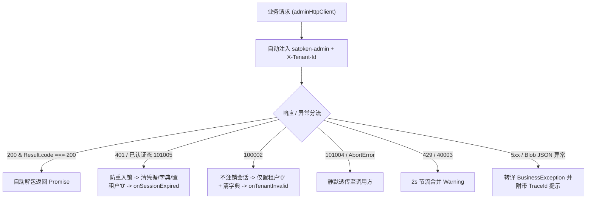

# ateng-solid-admin-web 管理后台前端工程

**ateng-solid-admin-web** 是 **ateng-solid** 全端开源上层框架的管理后台 Web 前端工程，基于 [`ateng-ui`](https://github.com/atengk/ateng-ui) 基础设施套件（`@atengk/core`、`@atengk/vue`、`@atengk/element-plus`）与 **TailwindCSS v4（禁用 Preflight）+ `Precision Slate & Cobalt` 自有令牌**混合样式架构构建。

> `Spec 1` ~ `Spec 4` 全量能力已交付并通过 Vitest 三层离线自洽单测与四合一门禁：覆盖 `Spec 1`（`Precision Slate & Cobalt` 设计令牌、三单例 HTTP、双轨字典与隔离基线）、`Spec 2`（方案 A 轻量布局壳与 `/login`、`/dashboard`、`/profile`、`/system/online`）、`Spec 3`（组织与 RBAC 全套视图 `/system/{dept,post,menu,role,user}` 含 Fesod 500 行导入批注导出，以及可开关 SaaS `/system/{tenant,tenant-package}` 含缩减裁剪预览）与 `Spec 4`（`/system/{dict,config,oper-log,login-log}`）。

---

## 0. 已落地前端基线全景速查矩阵 (`Spec 1` ~ `Spec 4` 全量基线)

| 能力域          | 文件 / 导出成员                                                                                                                                                                                                                                                                                                         | 关键机制 / 契约路径                                                                                                                                                                                     | 核心职责与边界守卫                                                                                                                                           | 锚定验证测试 (`*.spec.ts`)                                                                     |
| :-------------- | :---------------------------------------------------------------------------------------------------------------------------------------------------------------------------------------------------------------------------------------------------------------------------------------------------------------------- | :------------------------------------------------------------------------------------------------------------------------------------------------------------------------------------------------------ | :----------------------------------------------------------------------------------------------------------------------------------------------------------- | :--------------------------------------------------------------------------------------------- |
| 首屏防闪烁与页标 | [`index.html`](./index.html)、[`public/favicon.svg`](./public/favicon.svg) | `localStorage.getItem('solid-theme-mode')`、自适应矢量 Favicon | `<head>` 同步脚本预补 `html.dark`，并挂载随系统亮暗标签栏自适应切换的方案 B 三阶基座矢量 Favicon | `vite build` / 人工验证 |
| 自有视觉令牌    | [`src/styles/tokens.css`](./src/styles/tokens.css)                                                                                                                                                                                                                                                                      | `--solid-*`、`--solid-mark-*`、`--el-color-primary*`、`--at-shadow-focus-ring` | 全局唯一 Hex 真源，静态定义 Light (`#1D4ED8`) / Dark (`#3B82F6`) 双态及品牌主标双阶透明令牌 | `vite build` |
| 混合样式入口    | [`src/styles/main.css`](./src/styles/main.css)                                                                                                                                                                                                                                                                          | `@theme`、`@custom-variant dark`、`.tabular-nums`                                                                                                                                                       | 严格 6 段导入序，彻底剥离 `theme-pro.css` 且禁 `preflight.css`                                                                                               | [`tests/smoke.spec.ts`](./tests/smoke.spec.ts)                                                 |
| HTTP 与会话单例 | [`src/utils/http.ts`](./src/utils/http.ts)                                                                                                                                                                                                                                                                              | `adminAuthManager`、`adminTenantManager`、`adminHttpClient`、`registerHttpErrorHandlers`、`isGlobalHandledHttpError`、`resolveErrorMessage`、`formatBatchPathIds`                                       | 注入 `satoken-admin` / `X-Tenant-Id`；仅拦截 `500..599`/网络异常与认证限流码，透传 `102002`/`102005`/`102007` 域错误，提供批量删除路径归一函数               | [`tests/utils/http.spec.ts`](./tests/utils/http.spec.ts)                                       |
| 双轨字典引擎    | [`src/utils/dict.ts`](./src/utils/dict.ts)                                                                                                                                                                                                                                                                              | `setupDictManager`、`normalizeTagType`                                                                                                                                                                  | `/[A-Z]/` 路由静态枚举、`snake_case` 路由动态字典，滤除 `'default'`                                                                                          | [`tests/utils/dict.spec.ts`](./tests/utils/dict.spec.ts)                                       |
| 图标解析工具    | [`src/utils/icon.ts`](./src/utils/icon.ts)                                                                                                                                                                                                                                                                              | `resolveMenuIcon`、`TAB_MENU_ICONS`、`ALL_ELEMENT_ICONS`、`EXTRA_ELEMENT_ICONS`                                                                                                                         | `Map` 安全解析 `@element-plus/icons-vue`，并导出剔除内建重复项的全量扩展图标集合供 `AtengIconSelect` 检索                                                    | [`tests/utils/icon.spec.ts`](./tests/utils/icon.spec.ts)                                       |
| 树形与区间工具  | [`src/utils/tree.ts`](./src/utils/tree.ts)、[`src/utils/dateRange.ts`](./src/utils/dateRange.ts)、[`src/composables/useTreeTableControls.ts`](./src/composables/useTreeTableControls.ts) | `collectTreeSubtreeIds`、`flattenTreeNodes`、`createDateTimeRangeBinding`、`buildDateTimeShortcuts`、`useTreeTableControls` | 泛化子树防自环收集、用户/审计共享起止时间双向绑定与快捷预设、无分页树表防双发控制 | [`tests/components/OrgMenuViews.spec.ts`](./tests/components/OrgMenuViews.spec.ts) · [`AuditLogViews.spec.ts`](./tests/components/AuditLogViews.spec.ts) |
| 表单协同组合式  | [`useDetailDialogState.ts`](./src/composables/useDetailDialogState.ts)、[`useConfirmAction.ts`](./src/composables/useConfirmAction.ts)                                                                                                                                                                                  | `useDetailDialogState`、`runConfirmedAction`                                                                                                                                                            | 编辑弹窗详情异步竞态序号守卫、加载失败禁确认、统一警告级二次确认与错误防重收敛                                                                               | [`tests/components/DictConfigViews.spec.ts`](./tests/components/DictConfigViews.spec.ts)       |
| 列表视口布局    | [`useListTableLayout.ts`](./src/composables/useListTableLayout.ts) | `QUERY_COLS_TWO_ITEMS`、`QUERY_COLS_THREE_ITEMS`、`TABLE_AUTO_HEIGHT_OFFSET`、`useListTableLayout` | 统一全站 12 个业务页（13 张表）检索单行断点列数与桌面横排 `auto-height-mode="max"` 弹性封顶（移动端/堆叠态自动退回整页滚动） | [`tests/components/ListTableLayout.spec.ts`](./tests/components/ListTableLayout.spec.ts) |
| 通用与路由类型  | [`src/api/types.ts`](./src/api/types.ts)、[`src/types/router.ts`](./src/types/router.ts)                                                                                                                                                                                                                                | `CommonStatus`、`GenderValue`、`MenuType`、`SidebarMenuGroup`、`` `OptionItem<T>` ``、`RouteMeta` 扩展                                                                                                  | 跨模块基础强类型原语与路由元数据扩展（零 `any`、雪花 ID 一律 `string`）                                                                                      | `vue-tsc --noEmit`                                                                             |
| 认证中心 API    | [`src/api/auth/index.ts`](./src/api/auth/index.ts)、[`src/api/auth/types.ts`](./src/api/auth/types.ts)                                                                                                                                                                                                                  | `getCaptcha`、`login`、`logout`、`getAuthInfo`、`getAuthRoutes`、`getPersonalProfile`、`updatePersonalProfile`、`uploadProfileAvatar`、`updatePassword`、`getOnlineSessionPage`、`kickoutOnlineSession` | 1:1 强类型覆盖 `/admin/auth/**` 全量 11 个端点；数组与 `` `PageResult<OnlineSessionVO>` `` 均空安全兜底 `[]`                                                 | [`tests/api/auth.spec.ts`](./tests/api/auth.spec.ts)                                           |
| 多租户与套餐 API | [`src/api/system/tenant.ts`](./src/api/system/tenant.ts)、[`src/api/system/tenant-package.ts`](./src/api/system/tenant-package.ts) | `getTenantOptions`、`getTenantPage`/`Detail`/`createTenant`/`updateTenant`/`Status`/`deleteTenants` · `getTenantPackage*`、`previewPackageShrink` | 完整覆盖 SaaS 租户 4 步初始化（`CreateTenantVO`）、`0` 号保护与套餐全 CRUD 及缩减裁剪 `shrink-preview`（数组空值统一兜底 `[]`） | [`tests/api/auth.spec.ts`](./tests/api/auth.spec.ts) · [`tests/components/TenantPackageViews.spec.ts`](./tests/components/TenantPackageViews.spec.ts) |
| 静态枚举 API    | [`src/api/system/enum.ts`](./src/api/system/enum.ts)                                                                                                                                                                                                                                                                    | `getAllEnums`、`getEnumByName`、`getEnumsBatch`                                                                                                                                                         | 对接 `GET /admin/system/enums*` 与 `POST /admin/system/enums/batch`                                                                                          | [`tests/utils/dict.spec.ts`](./tests/utils/dict.spec.ts)                                       |
| 动态字典 API    | [`src/api/system/dict.ts`](./src/api/system/dict.ts)                                                                                                                                                                                                                                                                    | `getDictTypePage`/`Options`/`Detail`/`create`/`update`/`Status`/`delete`、`getDictDataPage`/`Detail`/`ByType`/`create`/`update`/`Status`/`delete`                                                       | 完整覆盖 `SysDictController` 全量 14 个端点（类型管理、明细维护及全租户只读消费）                                                                            | [`tests/components/DictConfigViews.spec.ts`](./tests/components/DictConfigViews.spec.ts)       |
| 系统参数 API    | [`src/api/system/config.ts`](./src/api/system/config.ts)                                                                                                                                                                                                                                                                | `getConfigPage`、`getConfigDetail`、`getConfigByKey`、`createConfig`、`updateConfig`、`deleteConfigs`                                                                                                   | 对接 `SysConfigController` 全量 6 个端点，覆盖租户级参数检索与键值回退读取                                                                                   | [`tests/components/DictConfigViews.spec.ts`](./tests/components/DictConfigViews.spec.ts)       |
| 组织与 RBAC API | [`src/api/system/dept.ts`](./src/api/system/dept.ts)、[`src/api/system/post.ts`](./src/api/system/post.ts)、[`src/api/system/menu.ts`](./src/api/system/menu.ts)、[`src/api/system/role.ts`](./src/api/system/role.ts)、[`src/api/system/user.ts`](./src/api/system/user.ts)、[`userTypes.ts`](./src/api/system/userTypes.ts) | `getDept*`、`getPost*`、`getMenu*`、`getRole*`/`updateRoleDataScope`、`getUser*`/`resetUserPassword`/`downloadUserImportTemplate`/`importUsers` (`120_000ms`)/`downloadImportFeedback`/`exportUsers` | 1:1 强类型覆盖部门、岗位、菜单、角色（5 级 `@DataScope`）与用户全量 CRUD 及 Fesod 导入批注导出 | [`OrgMenuViews.spec.ts`](./tests/components/OrgMenuViews.spec.ts) · [`RoleTreeHelpers.spec.ts`](./tests/components/RoleTreeHelpers.spec.ts) · [`UserImportDialog.spec.ts`](./tests/components/UserImportDialog.spec.ts) |
| 审计日志 API    | [`src/api/system/log.ts`](./src/api/system/log.ts)                                                                                                                                                                                                                                                                      | `getOperLogPage`、`getOperLogDetail`、`getLoginLogPage`                                                                                                                                                 | 1:1 强类型覆盖 `SysLogController` 只读审计检索 3 端点；雪花 ID 一律为 `string`，`status: 0 \| 1` 联合约束                                                    | [`tests/components/AuditLogViews.spec.ts`](./tests/components/AuditLogViews.spec.ts)           |
| 认证权限 Store  | [`src/stores/auth.ts`](./src/stores/auth.ts)                                                                                                                                                                                                                                                                            | `useAuthStore`（`token`、`user`、`roles`、`permissions`、`isInitialized`、`tenantEnabled`、`login`、`fetchUserInfo`、`logout`、`clearLocalSession`、`hasPermission`、`hasRole`、`updateUserSummary`）   | 代理 `useAuth({ authManager: adminAuthManager, superAdminRoles: ['super_admin'] })` 共享 `WeakMap`，杜绝 `admin` 免检；登录/清理同步复位初始改密会话暂隐标记 | [`tests/stores/auth.spec.ts`](./tests/stores/auth.spec.ts)                                     |
| 多租户 Store    | [`src/stores/tenant.ts`](./src/stores/tenant.ts)                                                                                                                                                                                                                                                                        | `useTenantStore`（`activeTenantId`、`isSuperAdminTenantSwitchAllowed`、`isObservingTenant`、`switchTenant`、`resetToPlatform`、`recoverFromInvalidTenant`）                                             | 桥接 `adminTenantManager`；锁定普通用户归属租户；7 步强时序切租户；`100002` 回退 `'0'` 不断会话                                                              | [`tests/stores/tenant.spec.ts`](./tests/stores/tenant.spec.ts)                                 |
| 动态菜单 Store  | [`src/stores/permission.ts`](./src/stores/permission.ts)                                                                                                                                                                                                                                                                | `usePermissionStore`（`rawMenus`、`sidebarGroups`、`routesLoaded`、`registeredRouteNames`、`buildRoutes`、`resetRoutes`）                                                                               | 纯内存维护；`import.meta.glob('../views/**/*.vue')` 动态映射与 404 安全降级；精确 `removeRoute`                                                              | [`tests/stores/permission.spec.ts`](./tests/stores/permission.spec.ts)                         |
| UI 偏好 Store   | [`src/stores/app.ts`](./src/stores/app.ts)                                                                                                                                                                                                                                                                              | `useAppStore`、`initAppTheme`、`cleanupAppTheme`                                                                                                                                                        | 仅存 `solid-theme-mode`/`solid-sidebar-collapsed`/`solid-show-tabs`；提供 `registerTabsResetHandler` 与 `dispose` 资源清理                                   | [`tests/stores/auth.spec.ts`](./tests/stores/auth.spec.ts)                                     |
| 静态路由与守卫  | [`src/router/routes.ts`](./src/router/routes.ts)、[`src/router/guards.ts`](./src/router/guards.ts)、[`src/router/index.ts`](./src/router/index.ts)                                                                                                                                                                      | `staticRoutes`、`setupRouterGuards`、`sanitizeRedirectTarget`、`resolveAuthenticatedRedirectTarget`、`createAppRouter`                                                                                  | 匿名白名单、同源单斜杠 `redirect` 防开放重定向、首次并行拉取 `info`+`routes`、零菜单 `/403` 保护及 `AtengLoadingBar` 联动                                    | [`tests/router/guards.spec.ts`](./tests/router/guards.spec.ts)                                 |
| 强口令校验工具  | [`src/utils/password.ts`](./src/utils/password.ts)                                                                                                                                                                                                                                                                      | `evaluatePasswordPolicy`、`PASSWORD_MIN_LENGTH`、`PASSWORD_MAX_LENGTH`、`PASSWORD_MIN_CATEGORIES`                                                                                                       | 1:1 等价对齐后端 `PasswordPolicyValidator`（`8~20` 位、禁 ISO 控制与空白字符、ASCII 4 类字符至少命中 3 类）                                                  | [`tests/components/ProfileView.spec.ts`](./tests/components/ProfileView.spec.ts)               |
| 应用启动入口    | [`src/main.ts`](./src/main.ts)                                                                                                                                                                                                                                                                                          | 8 步确定性装配时序                                                                                                                                                                                      | `initAppTheme` ➔ `setupDictManager` ➔ `pinia` ➔ `ElementPlus` ➔ `createAtengVue` ➔ `AtengElementPlus` ➔ `guards+router` ➔ `mount`                            | `vue-tsc` / `vite build`                                                                       |
| 根组件容器      | [`src/App.vue`](./src/App.vue)                                                                                                                                                                                                                                                                                          | `<el-config-provider :locale="zhCn">` + `<router-view />`                                                                                                                                               | 全站注入 Element Plus 中文语言包并承载路由出口                                                                                                               | [`tests/smoke.spec.ts`](./tests/smoke.spec.ts)                                                 |
| 方案 A 布局壳   | [`AdminLayout.vue`](./src/layouts/AdminLayout.vue)、[`AdminSidebar.vue`](./src/layouts/AdminSidebar.vue)、[`AdminHeader.vue`](./src/layouts/AdminHeader.vue)、[`TenantObserveBanner.vue`](./src/layouts/TenantObserveBanner.vue)、[`layoutHelper.ts`](./src/layouts/layoutHelper.ts)                                    | `useTabsNav`、`AtengTabsNav`、`ATENG_PRO_LAYOUT_KEY`、`SOLID_LAYOUT_TABS_KEY`                                                                                                                           | `228px`/`60px` 平铺分组侧栏、`48px` 顶栏、`36px` 线型页签（单源批关闭）与观察态琥珀金通栏；含 `Esc` 退出最大化与 `<768px` 抽屉                               | [`tests/components/AdminLayout.spec.ts`](./tests/components/AdminLayout.spec.ts)               |
| 全局布局组件    | [`BrandLogo.vue`](./src/components/BrandLogo.vue)、[`TenantSwitcher.vue`](./src/components/TenantSwitcher.vue)、[`ThemeToggle.vue`](./src/components/ThemeToggle.vue)、[`CommandPalette.vue`](./src/components/CommandPalette.vue) | `BrandMark`、`tenantEnabled`、`setThemeMode`、`Ctrl+K` / `Cmd+K` | 方案 B 三阶基座品牌组合标（`primary`/`dark-panel`/`inverse`）；超管可搜切租户 / 普通租户只读胶囊 / 单租户隐身；明暗主题切换；可见菜单快捷键搜索跳转 | [`tests/components/ShellControls.spec.ts`](./tests/components/ShellControls.spec.ts) · [`AdminLayout.spec.ts`](./tests/components/AdminLayout.spec.ts) |
| 通用协作组件    | [`FormErrorBanner.vue`](./src/components/FormErrorBanner.vue)、[`PasswordPolicyChecklist.vue`](./src/components/PasswordPolicyChecklist.vue)、[`TreeSelectionToolbar.vue`](./src/components/TreeSelectionToolbar.vue) | 内联报错横幅、3 项强口令实时清单、树形展开/全选/联动工具栏 | 统一收口弹窗/抽屉提交报错现场保留、强口令视觉即时反馈与角色/套餐菜单树操作工具栏 | [`RoleTreeHelpers.spec.ts`](./tests/components/RoleTreeHelpers.spec.ts) · [`UserImportDialog.spec.ts`](./tests/components/UserImportDialog.spec.ts) |
| 异常兜底页      | [`403.vue`](./src/views/error/403.vue)、[`404.vue`](./src/views/error/404.vue)、[`ErrorResultShell.vue`](./src/views/error/ErrorResultShell.vue)                                                                                                                                                                        | `/403`、`/:pathMatch(.*)*`                                                                                                                                                                              | `403` 对持菜单登录态嵌入壳内，对零菜单登录态提供 `[退出登录]` 防死锁出口；`404` 提供回工作台、返回上一页与关闭当前页签                                       | [`tests/components/ShellControls.spec.ts`](./tests/components/ShellControls.spec.ts)           |
| 登录认证视图    | [`login/index.vue`](./src/views/login/index.vue)、[`LoginBrandPanel.vue`](./src/views/login/components/LoginBrandPanel.vue)、[`useLoginAuth.ts`](./src/views/login/useLoginAuth.ts)                                                                                                                                     | `/login`（路由名 `Login`）、`GET /admin/auth/captcha`、`POST /admin/auth/login`                                                                                                                         | 方案 C 1040px 建筑双栏与深岩三阶线稿水印、内嵌单源 `ThemeToggle`、隐藏 `*` 红星、40px 等高 `AtengCaptcha :refresh`、`101004` ACCOUNT/IP 锁定倒计时、半态回滚与同源 `redirect` | [`tests/components/LoginView.spec.ts`](./tests/components/LoginView.spec.ts)                   |
| 轻量工作台视图  | [`dashboard/index.vue`](./src/views/dashboard/index.vue)                                                                                                                                                                                                                                                                | `/dashboard`（路由名 `Dashboard`，`affix: true, keepAlive: true`）                                                                                                                                      | 初始口令非阻塞提醒（同会话暂隐/重登恢复）、身份与租户观察摘要、动态权限快捷入口网格、0 菜单受限卡（附 `[退出登录]`）                                         | [`tests/components/DashboardAndOnline.spec.ts`](./tests/components/DashboardAndOnline.spec.ts) |
| 个人中心视图    | [`profile/index.vue`](./src/views/profile/index.vue)、[`ProfileBasicForm.vue`](./src/views/profile/components/ProfileBasicForm.vue)、[`ProfilePasswordForm.vue`](./src/views/profile/components/ProfilePasswordForm.vue)                                                                                                | `/profile`（路由名 `Profile`）、`/admin/auth/profile*`、`PUT /admin/auth/password`                                                                                                                      | `AtengDescriptions` 脱敏+真明文复制、`AtengUpload` 头像直传（`<=2MB`）、真明文资料编辑、4 项实时强口令清单及改密清会话重登                                   | [`tests/components/ProfileView.spec.ts`](./tests/components/ProfileView.spec.ts)               |
| 在线会话视图    | [`system/online/index.vue`](./src/views/system/online/index.vue)                                                                                                                                                                                                                                                        | `/system/online`（`auth:online:list`、`auth:online:kickout`，`keepAlive: false`）                                                                                                                       | `usePagination` + `AtengQueryForm` + `AtengTable`、`tokenMask`、`[当前会话]` 禁强退、CIDR IP 筛选、`101007` 收敛与确认强退                                   | [`tests/components/DashboardAndOnline.spec.ts`](./tests/components/DashboardAndOnline.spec.ts) |
| 部门树管理视图  | [`system/dept/index.vue`](./src/views/system/dept/index.vue)、[`DeptFormDialog.vue`](./src/views/system/dept/components/DeptFormDialog.vue)、[`deptHelper.ts`](./src/views/system/dept/deptHelper.ts)                                                                                                                   | `/system/dept`（路由名 `SysDept`，`system:dept:*`）                                                                                                                                                     | 树形表与展开/折叠、列表手机 `formatMaskPhone` 脱敏而弹窗真明文、编辑禁用自身与子孙防自环、负责人远程检索、停用禁加子级                                       | [`tests/components/OrgMenuViews.spec.ts`](./tests/components/OrgMenuViews.spec.ts)             |
| 岗位管理视图    | [`system/post/index.vue`](./src/views/system/post/index.vue)、[`PostFormDialog.vue`](./src/views/system/post/components/PostFormDialog.vue)                                                                                                                                                                             | `/system/post`（路由名 `SysPost`，`system:post:*`）                                                                                                                                                     | `usePagination` + `AtengQueryForm` + 多选批量删除（未选禁用）、状态 Switch 二次确认、`102002`/`102005` 精准提示                                              | [`tests/components/OrgMenuViews.spec.ts`](./tests/components/OrgMenuViews.spec.ts)             |
| 菜单权限视图    | [`system/menu/index.vue`](./src/views/system/menu/index.vue)、[`MenuFormDrawer.vue`](./src/views/system/menu/components/MenuFormDrawer.vue)、[`menuHelper.ts`](./src/views/system/menu/menuHelper.ts)、[`menuFormRules.ts`](./src/views/system/menu/menuFormRules.ts)                                                   | `/system/menu`（路由名 `SysMenu`，`system:menu:*`）                                                                                                                                                     | `M`/`C`/`F` 与外链动态表单抽屉（`500px`）、提交前字段清洗、防降级限制、`platformOnly` 继承锁定与全量图标检索                                                 | [`tests/components/OrgMenuViews.spec.ts`](./tests/components/OrgMenuViews.spec.ts)             |
| 角色权限视图    | [`system/role/index.vue`](./src/views/system/role/index.vue)、[`RoleFormDrawer.vue`](./src/views/system/role/components/RoleFormDrawer.vue)、[`RoleDataScopeDialog.vue`](./src/views/system/role/components/RoleDataScopeDialog.vue)、[`roleHelper.ts`](./src/views/system/role/roleHelper.ts) | `/system/role`（路由名 `SysRole`，`system:role:*`） | `super_admin` 平台内置保护、菜单授权抽屉（`500px` · 联动态叶子回显 + 半选合并）及 `520px` 5 级 `@DataScope` 弹窗（`CUSTOM` 自定部门必选） | [`tests/components/RoleTreeHelpers.spec.ts`](./tests/components/RoleTreeHelpers.spec.ts) |
| 用户管理视图    | [`system/user/index.vue`](./src/views/system/user/index.vue)、[`UserDeptSidebar.vue`](./src/views/system/user/components/UserDeptSidebar.vue)、[`UserFormDrawer.vue`](./src/views/system/user/components/UserFormDrawer.vue)、[`UserResetPwdDialog.vue`](./src/views/system/user/components/UserResetPwdDialog.vue)、[`UserImportDialog.vue`](./src/views/system/user/components/UserImportDialog.vue)、[`UserRowActions.vue`](./src/views/system/user/components/UserRowActions.vue)、[`userHelper.ts`](./src/views/system/user/userHelper.ts) | `/system/user`（路由名 `SysUser`，`system:user:*`） | `AtengSplitLayout` 左右分栏（左部门树子树过滤）、精确 11 位手机检索、脱敏/明文隔离、停用部门岗位回显兜底、超管/自身保护、强口令重置及 120s 批量导入批注与流式导出 | [`tests/components/UserImportDialog.spec.ts`](./tests/components/UserImportDialog.spec.ts) |
| 多租户管理视图  | [`system/tenant/index.vue`](./src/views/system/tenant/index.vue)、[`TenantFormDrawer.vue`](./src/views/system/tenant/components/TenantFormDrawer.vue)、[`TenantInitCredentialDialog.vue`](./src/views/system/tenant/components/TenantInitCredentialDialog.vue)、[`tenantHelper.ts`](./src/views/system/tenant/tenantHelper.ts) | `/system/tenant`（路由名 `SysTenant`，`system:tenant:*`） | 仅多租户开启平台 `"0"` 可见；`0` 号默认租户保护、配额与过期标签、停用套餐回显、`520px` 原子初始化后一次性凭据弹窗及停删强退警示 | [`tests/components/TenantPackageViews.spec.ts`](./tests/components/TenantPackageViews.spec.ts) |
| 租户套餐视图    | [`system/tenant-package/index.vue`](./src/views/system/tenant-package/index.vue)、[`PackageFormDrawer.vue`](./src/views/system/tenant-package/components/PackageFormDrawer.vue)、[`PackageShrinkConfirmDialog.vue`](./src/views/system/tenant-package/components/PackageShrinkConfirmDialog.vue)、[`tenantPackageHelper.ts`](./src/views/system/tenant-package/tenantPackageHelper.ts) | `/system/tenant-package`（路由名 `SysTenantPackage`，`system:tenant-package:*`） | 主动排除 `platformOnly` 与停用菜单双防线、停用不影响存量租户、`720px` 抽屉编辑缩减前置调用 `shrink-preview` 弹出受影响租户与移除菜单确认弹窗 | [`tests/components/TenantPackageViews.spec.ts`](./tests/components/TenantPackageViews.spec.ts) |
| 动态字典视图    | [`system/dict/index.vue`](./src/views/system/dict/index.vue)、[`DictDataPanel.vue`](./src/views/system/dict/components/DictDataPanel.vue)、[`DictTypeFormDialog.vue`](./src/views/system/dict/components/DictTypeFormDialog.vue)、[`DictDataFormDialog.vue`](./src/views/system/dict/components/DictDataFormDialog.vue) | `/system/dict`（路由名 `SysDict`，`system:dict:*`）                                                                                                                                                     | `AtengSplitLayout` 同屏双面板（`<1120px` 上下堆叠）、首条自动联动、编辑锁 `dictType`、6 档 `AtengDictTag` 预览与 `DictManager.clearCache(dictType)` 清理     | [`tests/components/DictConfigViews.spec.ts`](./tests/components/DictConfigViews.spec.ts)       |
| 系统参数视图    | [`system/config/index.vue`](./src/views/system/config/index.vue)、[`ConfigFormDialog.vue`](./src/views/system/config/components/ConfigFormDialog.vue)                                                                                                                                                                   | `/system/config`（路由名 `SysConfig`，`system:config:*`）                                                                                                                                               | 消费静态枚举 `configType`；内置参数 `Y` 禁选/禁删/锁键名、`sys.user.initPassword` 复用全站未裁剪强口令策略                                                   | [`tests/components/DictConfigViews.spec.ts`](./tests/components/DictConfigViews.spec.ts)       |
| 操作审计日志    | [`system/oper-log/index.vue`](./src/views/system/oper-log/index.vue)、[`OperLogDetailDrawer.vue`](./src/views/system/oper-log/components/OperLogDetailDrawer.vue)、[`AuditTraceCell.vue`](./src/views/system/log/components/AuditTraceCell.vue)、[`logHelper.ts`](./src/views/system/log/logHelper.ts)                  | `/system/oper-log`（路由名 `SysOperLog`，`keepAlive: false`）                                                                                                                                           | 严格只读（无增删改/清空/导出）；首行 4 筛选 + 展开 `traceId`/时间区间；`720px` 抽屉提供插槽防空短路、`240px` 限高滚动 JSON 美化与 `errorMsg` 摘要            | [`tests/components/AuditLogViews.spec.ts`](./tests/components/AuditLogViews.spec.ts)           |
| 登录审计日志    | [`system/login-log/index.vue`](./src/views/system/login-log/index.vue)、[`AuditTraceCell.vue`](./src/views/system/log/components/AuditTraceCell.vue)、[`logHelper.ts`](./src/views/system/log/logHelper.ts)                                                                                                             | `/system/login-log`（路由名 `SysLoginLog`，`keepAlive: false`）                                                                                                                                         | 严格只读（无增删改/清空/导出）；首行 3 筛选 + 展开 `traceId`/时间区间；空 `loginLocation` 安全回落 `--` 并复用 `TraceId` 一键复制                            | [`tests/components/AuditLogViews.spec.ts`](./tests/components/AuditLogViews.spec.ts)           |
| 测试隔离基线    | [`tests/setup.ts`](./tests/setup.ts)、[`vitest.config.ts`](./vitest.config.ts)                                                                                                                                                                                                                                          | `setupFiles: ['tests/setup.ts']`                                                                                                                                                                        | 每个用例前后清空 Storage、`DictManager`、`useAuth` `WeakMap`、租户状态与 Mock                                                                                | 全量 `vitest run`                                                                              |

---

## 1. 工程定位、技术栈与质量门禁

- **技术基线**：Node.js `22+` / pnpm `11+` / Vue `3.5+` / Vite `6+` / TypeScript Strict / Vue Router / Pinia / Element Plus / TailwindCSS v4（无 Preflight）。
- **多环境与本地联调说明**：开发与生产公共变量分别收敛于受追踪的 `.env.development` 与 `.env.production`（完整模板见 [`.env.example`](./.env.example)），个人本机覆盖写入被 `.gitignore` 忽略的 `.env.local`；当前联调期本地保留 `.yalc/@atengk/element-plus`，正式提交 `package.json` 前须还原为已发布的 npm 正式版。

```bash
# 安装依赖与启动开发
pnpm install
pnpm dev

# 提交前四合一验证门禁
pnpm typecheck && pnpm lint && pnpm test && pnpm build
```

---

## 2. 核心链路与双轨分流架构



---

## 3. 核心基线能力详解

### 3.1 `Precision Slate & Cobalt` 令牌与无 Preflight 样式（`tokens.css` / `main.css`）

1. **配置基线（`src/styles/main.css` 6 段导入序 + `initTheme`）**：
   - 彻底移除 `@atengk/element-plus/theme-pro.css`，按序导入 `element-plus/dist/index.css` ➔ `element-plus/theme-chalk/dark/css-vars.css` ➔ `@atengk/element-plus/style.css` ➔ `./tokens.css` ➔ `tailwindcss/theme.css` ➔ `tailwindcss/utilities.css`。
2. **启动装配（提取自 [`src/stores/app.ts`](./src/stores/app.ts) 与 [`src/main.ts`](./src/main.ts)）**：

```ts
// src/stores/app.ts
sharedThemeManager = initTheme({
  storageKey: THEME_MODE_STORAGE_KEY,
  defaultMode: 'light',
  listenSystemPreference: true,
});

// src/main.ts
initAppTheme();
```

3. **边界防御**：`initTheme` 严禁传入 `themeColor`，避免内联样式覆盖 Light (`#1D4ED8`) / Dark (`#3B82F6`) 双主色切换；除 `tokens.css` 外全站样式与组件禁止硬编码十六进制颜色。

### 3.2 三单例 HTTP 客户端与全局错误分流（`src/utils/http.ts`）

1. **配置项（`.env.example`）**：

```ini
VITE_API_BASE_URL=
VITE_PROXY_TARGET=http://127.0.0.1:8080
```

2. **上层解耦回调注册（提取自 [`src/utils/http.ts`](./src/utils/http.ts)）**：

```ts
registerHttpErrorHandlers({
  onSessionExpired: async (_reason, _message) => {
    // 清理 Pinia 认证/动态路由状态并跳转 /login
  },
  onTenantInvalid: async _message => {
    // 刷新 /admin/auth/info 与 /admin/auth/routes 并回退 /dashboard
  },
});
```

3. **边界防御**：
   - `adminTenantManager` 本地为空时自动初始化写入 `'0'`；
   - `101005` 严格区分是否已认证请求（未认证态如登录表单提交直接透传业务异常，已认证态执行全端会话清理）；
   - `Blob` 下载遇 HTTP `4xx/5xx` 返回 JSON 错误体时，经 `checkBlobForJsonError` 二次兜底转译为强类型 `BusinessException`。

### 3.3 正交双轨 `DictManager` 与图标解析（`src/utils/dict.ts`、`src/utils/icon.ts`）

1. **装配调用（提取自 `src/main.ts` 与 `src/utils/icon.ts`）**：

```ts
setupDictManager();
const icon = resolveMenuIcon('UserFilled');
```

2. **真实请求协议**：
   - 静态枚举（`/[A-Z]/`，如 `dataScopeType`）：单查 `GET /admin/system/enums/{name}`，批查合并发送 `POST /admin/system/enums/batch`（请求体直传字符串数组 `string[]`）；
   - 动态字典（纯小写 `snake_case`，如 `sys_user_gender`）：走 `GET /admin/system/dict/data/type/{dictType}`；
   - `normalizeTagType` 统一过滤 `'default'`、空白与非法值返回 `undefined`，避免 Tag 渲染报错；
   - `resolveMenuIcon` 支持 PascalCase、kebab-case 与 `el-icon-*` 前缀，基于 `Map` 查找绝不命中 `toString`/`constructor` 等原型链键。

### 3.4 认证、多租户状态与动态路由守卫（`src/stores/`、`src/router/`、`src/main.ts`）

1. **配置与启动装配（提取自 [`src/main.ts`](./src/main.ts)）**：
   - 严格遵循 8 步启动顺序：`initAppTheme()` ➔ `setupDictManager()` ➔ `app.use(pinia)` ➔ `app.use(ElementPlus, { locale: zhCn })` ➔ `app.use(createAtengVue({ httpClient: adminHttpClient, authManager: adminAuthManager, tenantManager: adminTenantManager, superAdminRoles: ['super_admin'], defaultSize: 10 }))` ➔ `app.use(AtengElementPlus)` ➔ 接线 `registerHttpErrorHandlers` + `setupRouterGuards(router, pinia)` + `app.use(router)` ➔ `app.mount('#app')`。
2. **核心调用示例（提取自 [`src/stores/auth.ts`](./src/stores/auth.ts) 与 [`src/stores/tenant.ts`](./src/stores/tenant.ts)）**：

```ts
const authStore = useAuthStore(pinia);
const tenantStore = useTenantStore(pinia);

await authStore.login(loginForm);
await Promise.all([authStore.fetchUserInfo(), permissionStore.buildRoutes(router)]);
await tenantStore.switchTenant('10002', router);
```

3. **边界防御**：
   - **单源权限零漂移**：`useAuthStore` 代理 `useAuth({ authManager: adminAuthManager, superAdminRoles: ['super_admin'] })` 底层 `WeakMap`，彻底隔离并禁用 `'admin'` 默认超管免检；
   - **超管 7 步切租户与 `100002` 回退**：普通租户用户在 `initForUser` 强制矫正回真实归属 `tenantId` 并阻断越权切换；超管切换按“写租户头 ➔ 清字典 ➔ 关非固定页签 ➔ 卸旧路由 ➔ 并行重拉 `info`+`routes` ➔ 不可见页面回退 `/dashboard` ➔ 更新名称”严格串行执行，遇 `100002` 回退 `'0'` 且不注销平台超管会话；
   - **安全守卫与 404 降级**：未登录仅放行 `/login` 与 `/403`（未知路径跳 `/login?redirect=...`）；`sanitizeRedirectTarget` 递归解码拦截协议外链（`https://`、`//`、`/\`）与 `/login`/`/403`/`/404`；动态 `component` 在 `import.meta.glob('../views/**/*.vue')` 未命中时自动降级 404，零菜单账户访问未授权动态路径重定向至 `/403`。

### 3.5 方案 A 轻量布局壳与全局协同组件（`src/layouts/`、`src/components/`、`src/views/error/`）

1. **核心配置与布局骨架（[`AdminLayout.vue`](./src/layouts/AdminLayout.vue)）**：
   - 采用 TailwindCSS v4 Flex 构筑 `228px`/`60px` 侧栏（[`AdminSidebar.vue`](./src/layouts/AdminSidebar.vue)）、`48px` 单行顶栏（[`AdminHeader.vue`](./src/layouts/AdminHeader.vue)）、`36px` 线型多页签栏（`AtengTabsNav`）与 `36px` 跨租户观察态琥珀金通栏（[`TenantObserveBanner.vue`](./src/layouts/TenantObserveBanner.vue)），完全基于 `--solid-*` 语义令牌，零负 `margin` 与零全局 `!important`。
2. **真实调用绑定（提取自 [`AdminLayout.vue`](./src/layouts/AdminLayout.vue)）**：

```vue
<AtengTabsNav
  v-if="appStore.showTabsBar"
  :model-value="tabsNav.activeKey.value"
  :tabs="tabsNav.tabs.value"
  style-type="line"
  height="36px"
  :emit-close-on-batch="false"
  :is-maximized="tabsNav.isMaximized.value"
  :icon-resolver="resolveTabIcon"
  :menu-icons="TAB_MENU_ICONS"
  @tab-click="handleTabClick"
  @tab-close="handleTabClose"
  @batch-close="handleBatchClose"
  @tab-refresh="handleTabRefresh"
  @tab-order-change="handleTabOrderChange"
  @update:is-maximized="handleUpdateMaximized"
/>
```

- 主骨架同时调用 `provide(ATENG_PRO_LAYOUT_KEY, layoutContext)` 与 `provide(SOLID_LAYOUT_TABS_KEY, ...)`，向子孙页面透传折叠态、侧栏宽度、最大化状态与关闭当前页签能力；[`BrandLogo.vue`](./src/components/BrandLogo.vue) 统一收口侧栏品牌区（展开态 `ateng-solid` 短名、折叠态居中图形且支持点击返回工作台）与登录双态品牌标，并严格遵循实例品牌归属（不随超管切换租户而变标）。

3. **边界防御**：
   - **单源批关闭与局部刷新**：关闭 `emitCloseOnBatch` 后经 `@batch-close` 一次性调用 `useTabsNav` 的 `closeOthers`/`closeLeft`/`closeRight`/`closeAll`，消除多标签连续关闭跳变；结合 `KeepAlive :include="tabsNav.cachedViews.value"` 与 `refreshingKey` 实现页签级原地重挂载；最大化模式同步隐藏左侧栏、顶栏与 `TenantObserveBanner`；
   - **全局监听回收与按键隔离**：`AdminLayout` 的 `Esc`/`resize`/`matchMedia` 监听与 [`CommandPalette.vue`](./src/components/CommandPalette.vue) 的 `Ctrl+K` / `Cmd+K` 监听均在 `onBeforeUnmount` 精确卸载，`tabsResetHandler` 同步置空；`CommandPalette` 展开时独占 `Esc`（`stopImmediatePropagation`），避免误退出底层工作区最大化；
   - **零菜单防死锁与观察态显式退出**：[`403.vue`](./src/views/error/403.vue) 对已登录持菜单账户自动嵌入 `AdminLayout`，对已登录零菜单账户显式渲染 `[退出登录]` 按钮避免死锁；[`TenantSwitcher.vue`](./src/components/TenantSwitcher.vue) 与 `TenantObserveBanner` 严格受 `tenantEnabled` 及 `isObservingTenant` 门控。

### 3.6 认证工作台、个人中心与在线会话视图（`src/views/{login,dashboard,profile,system/online}/`）

1. **客户端基线与令牌配置（[`src/styles/tokens.css`](./src/styles/tokens.css)、[`src/utils/password.ts`](./src/utils/password.ts)）**：
   - 左侧深岩品牌面板配色（`--solid-brand-panel-*`）、建筑网格/三阶基座线稿水印令牌（`--solid-brand-watermark-*`）与语义告警边框（`--solid-danger-border` 等）统一托管于 `tokens.css` 的 Light/Dark 双态变量；强口令策略常量对齐后端 `8~20` 位、禁止 ISO 控制与空白字符、至少包含 3 类 ASCII 字符。
2. **核心集成示例（提取自 [`src/views/login/useLoginAuth.ts`](./src/views/login/useLoginAuth.ts) 与 [`src/views/system/online/index.vue`](./src/views/system/online/index.vue)）**：

```ts
// 1. 登录认证前置安全配置拉取与成功跳转目标校验
await Promise.all([authStore.fetchUserInfo(), permissionStore.buildRoutes(router)]);
const targetPath = resolveAuthenticatedRedirectTarget(route.query.redirect, permissionStore);
await router.replace(targetPath);

// 2. 在线会话分页筛选与受控强退调用
const pagination = usePagination<OnlineSessionVO, OnlineSessionQuery>(getOnlineSessionPage, {
  defaultSize: 10,
});
await kickoutOnlineSession(sessionId);
```

3. **边界防御**：
   - **登录安全与防爆破闭环**：`<el-form>` 禁用 `:validate-on-rule-change` 防止动态规则首屏误标红，校验执行去首尾空格；`rememberAccount` 仅存勾选状态、租户编码与用户名（绝不写入密码）；`101004` 按 `ACCOUNT`（改账号或租户即时清零）与 `IP`（保留至倒计时归零）区分倒计时；若凭据签发后初始化身份或菜单失败立即调用 `clearLocalSession` 回滚半登录态；
   - **工作台与个人中心真明文隔离**：工作台初始口令提示条 `[本次不再提醒]` 绑定 `sessionStorage` 并在 `login`/`clearLocalSession` 自动清理以保障退出重登恢复；个人中心左栏通过 `AtengDescriptions`（`mask="phone"`/`mask="email"` + `:copyable="true"` + `.tabular-nums`）展示脱敏值并复制内存真明文，头像经 `AtengUpload :http-request` 校验 `<=2MB` 后直传并保留失败前旧头像，修改密码成功后调用 `logout({ remote: false, router })` 强制重登；
   - **在线会话自强退与权限防护**：`currentSession === true` 时禁用强退按钮并展示禁止原因提示；操作区域受 `v-permission="'auth:online:kickout'"` 统一控制，无权限时物理移除按钮及外层 Tooltip DOM；强退弹窗捕获 `101007` 等业务异常明示提示并保留弹窗，不因列表刷新异常阻断已成功强退后的弹窗关闭。

### 3.7 组织架构与基础 RBAC 视图（`src/views/system/{dept,post,menu}/`）

1. **树形表格与分页协同（提取自 [`src/composables/useTreeTableControls.ts`](./src/composables/useTreeTableControls.ts) 与 [`src/views/system/post/index.vue`](./src/views/system/post/index.vue)）**：

```ts
// 无分页树形表复用展开切换与查询重置防双发控制（SysDept / SysMenu）
const { tableRef, isAllExpanded, toggleExpandAll, handleQuerySearch, handleQueryReset } =
  useTreeTableControls<DeptTreeVO>({ treeData: deptTree, onLoad: loadDeptTree, onResetFields });

// 分页管理表仅向 AtengTable 传 :pagination，AtengQueryForm 绑定 pagination.query（SysPost）
const pagination = usePagination<PostVO, PostQuery>(getPostPage, { defaultSize: 10 });
```

2. **核心守卫与交互边界**：
   - **全局 HTTP 与域错误分层**：[`src/utils/http.ts`](./src/utils/http.ts) 收窄仅将 `500..599` 及网络异常码（`<= 0`）视作全局服务端故障弹窗，放行 `102002`（唯一性冲突）、`102005`（存在下级或用户关联）等 6 位域错误码；弹窗/抽屉内使用 `:confirm-loading="detailLoading ? true : undefined"` 保留 `beforeConfirm` 内联错误提示与现场保留能力；
   - **部门树（`SysDept`）防自环与脱敏隔离**：列表联系手机号经 `formatMaskPhone` 脱敏展示，编辑弹窗通过 `getDeptDetail` 加载内存真明文；`buildDeptSelectorOptions` 基于 `collectTreeSubtreeIds` 自动禁用自身及全部子孙防自环，对非原上级的已停用部门与已停用节点 `[新增下级]` 均加禁用与 Tooltip 提示；负责人消费 `getUserOptions` 远程检索；
   - **岗位（`SysPost`）分页与批量删除**：未选行时工具栏 `[批量删除]` 保持禁用；支持行内状态 Switch 二次确认后全表刷新同步，避免直接修改只读响应式列表项；
   - **菜单权限（`SysMenu`）动态字段与拓扑安全**：`MenuFormDrawer`（`500px`）随 `M`/`C`/`F` 与外链开关实时裁剪表单字段并在提交前执行 `sanitizeMenuSavePayload` 清洗；`getAllowedMenuTypesForEdit` 禁止含子节点目录/菜单降级；`isMenuParentPlatformOnly` 检测父链平台专属并锁定子节点 `platformOnly`；`<AtengIconSelect>` 注入剔除内建重复项的 `EXTRA_ELEMENT_ICONS`，合并提供全量 Element Plus 图标与拼音检索。

### 3.8 动态字典双面板与系统参数视图（`src/views/system/{dict,config}/`）

1. **双面板协同与缓存失效（提取自 [`src/views/system/dict/index.vue`](./src/views/system/dict/index.vue) 与 [`src/views/system/dict/components/DictDataPanel.vue`](./src/views/system/dict/components/DictDataPanel.vue)）**：

```ts
// 左侧字典类型加载完成自动定位首条明细；右侧仅通过请求包裹注入 dictType 保持检索 query 洁净
watch(
  () => props.selectedType?.dictType,
  (nextDictType, prevDictType) => {
    if (nextDictType !== prevDictType) {
      dataPagination.query.dictLabel = '';
      dataPagination.query.status = undefined;
      void dataPagination.search({ dictLabel: undefined, status: undefined });
    }
  },
);
DictManager.clearCache(row.dictType);
```

2. **核心守卫与交互边界**：
   - **双面板布局与空态区分（`SysDict`）**：`<AtengSplitLayout>` 桌面端 42%/58% 分栏并记忆于 `solid:split:sys-dict`，视口小于 `1120px` 自动切换垂直堆叠（关闭横向持久化防宽高串写）；左栏编辑锁定 `dictType` 只读、删除遇下级明细抛出 `102005` 整批提示；右栏列表通过 `<AtengDictTag>` 实时呈色，弹窗内嵌 6 档 `tagType` 预览与 `isDefault` 同类型互斥开关；增删改/启停与 `[刷新字典缓存]` 均精确调用 `DictManager.clearCache(dictType)`；
   - **内置参数防护与强口令约束（`SysConfig`）**：表格多选列 `:selectable` 与 `[删除]` 按钮对 `configType === 'Y'` 系统内置参数均置灰禁用，编辑态锁定 `configKey` 只读且不允许与业务自建类型 `N` 互转；当维护 `sys.user.initPassword` 时复用 `evaluatePasswordPolicy` 对未裁剪原始文本实时执行 8~20 位无空白且至少 3 类字符校验；
   - **共用详情防串行与确认收敛**：`useDetailDialogState` 通过自增请求序号防止弹窗快速重开回写错乱，并在详情拉取失败时隐藏确认按钮防止误提交；`runConfirmedAction` 统一收口警告级二次确认与错误提示。

### 3.9 只读审计日志与追踪检索视图（`src/views/system/{oper-log,login-log,log}/`）

1. **只读时间区间绑定与载荷安全美化（提取自 [`src/views/system/log/logHelper.ts`](./src/views/system/log/logHelper.ts)）**：

```ts
export function createTimeRangeBinding<T extends DateRangeQueryShape>(
  query: T,
): WritableComputedRef<[AuditDateRangeValue, AuditDateRangeValue] | null> {
  return computed<[AuditDateRangeValue, AuditDateRangeValue] | null>({
    get: (): [AuditDateRangeValue, AuditDateRangeValue] | null =>
      query.beginTime && query.endTime ? [query.beginTime, query.endTime] : null,
    set: (value: [AuditDateRangeValue, AuditDateRangeValue] | null | undefined) => {
      const start = value?.[0];
      const end = value?.[1];
      query.beginTime = typeof start === 'string' && start.trim() ? start : undefined;
      query.endTime = typeof end === 'string' && end.trim() ? end : undefined;
    },
  });
}
```

2. **核心守卫与交互边界**：
   - **严格只读契约**：`SysOperLog` 与 `SysLoginLog` 均不提供任何新增、编辑、删除、批量清空或导出操作按钮，确保审计证据链不可篡改；两页均设置 `keepAlive: false`，与各自表格持久化键 `solid:table:sys-oper-log` / `solid:table:sys-login-log` 配合保证每次进入拿到最新实时日志；
   - **查询栏响应折叠与时间绑定**：`<AtengQueryForm>` 在 `SysOperLog` 配置 `:cols="{ xs: 1, sm: 2, md: 3, lg: 5, xl: 5 }"`、在 `SysLoginLog` 配置 `:cols="{ xs: 1, sm: 2, md: 3, lg: 4, xl: 4 }"`，保障桌面端折叠首行分别稳定展示 `module`/`userName`/`operateType`/`status` 与 `username`/`clientIp`/`status`；`<AtengDateRange>` 结合 `createTimeRangeBinding` 在清空（emit `null`）与重置时同步把 `beginTime`/`endTime` 归一为 `undefined`；
   - **TraceId 复用与 720px 只读详查抽屉**：列表与详情共同复用 `AuditTraceCell` / `copyAuditText` 进行 `navigator.clipboard.writeText` 复制并兜底剪贴板异常；`OperLogDetailDrawer`（`size="720px"`）对 `userName`/`browser` 采用 `AtengDescriptions` 具名插槽避免主字段为空时跳过 `formatter`，并在限高可滚动面板（默认 `max-h-[240px]`、展开 `max-h-[480px]`）内对合法 JSON 执行 2 空格缩进美化、按需呈现 `extraJson` 扩展面板及 `max-h-[160px]` 限高失败异常摘要。

### 3.10 角色权限（5 级 `@DataScope`）与用户分栏/导入导出视图（`src/views/system/{role,user}/`）

1. **核心配置、超管保护与树勾选模型（[`roleHelper.ts`](./src/views/system/role/roleHelper.ts)、[`userHelper.ts`](./src/views/system/user/userHelper.ts)）**：
   - `SysRole`（表格存储键 `solid:table:sys-role`）与 `SysUser`（`AtengSplitLayout` 键 `solid:split:sys-user`、表格键 `solid:table:sys-user`，`< 960px` 自动切换上下堆叠）共同消费 [`FormErrorBanner.vue`](./src/components/FormErrorBanner.vue) 与 [`src/utils/dateRange.ts`](./src/utils/dateRange.ts)；[`UserFormDrawer.vue`](./src/views/system/user/components/UserFormDrawer.vue) 与 [`UserResetPwdDialog.vue`](./src/views/system/user/components/UserResetPwdDialog.vue) 统一集成 [`PasswordPolicyChecklist.vue`](./src/components/PasswordPolicyChecklist.vue) 对齐 8~20 位强口令规则。
2. **叶子回显防全选与 120s 批量导入流（提取自 [`roleHelper.ts`](./src/views/system/role/roleHelper.ts) 与 [`src/api/system/user.ts`](./src/api/system/user.ts)）**：

```ts
// 1. 联动态仅传入末端叶子主键 setCheckedKeys 防半选父目录误全选，提交合并半选父节点
const checkedKeys = resolveInitialCheckedMenuKeys(menuTree, detail.menuIds, strictly);
const menuIds = collectSubmittedMenuIds(checkedKeys, halfCheckedKeys, strictly);

// 2. 用户 Fesod 导入强制覆盖请求级 120_000ms 超时，批注下载经 adminHttpClient blob 取回
const result = await adminHttpClient.post<ImportResultVO, FormData>(
  '/admin/system/user/import', formData, { timeout: 120_000 },
);
```

3. **核心守卫与交互边界**：
   - **角色与 5 级 `@DataScope`（`SysRole`）**：平台内置 `super_admin` 禁用复选框、状态开关、编辑、数据权限与删除，工具栏保留编码校验拦截 `super_admin`/`admin`；[`RoleFormDrawer.vue`](./src/views/system/role/components/RoleFormDrawer.vue)（`500px`）复用 [`TreeSelectionToolbar.vue`](./src/components/TreeSelectionToolbar.vue) 控制展开/全选/父子联动并在切换联动模式时重算树勾选；[`RoleDataScopeDialog.vue`](./src/views/system/role/components/RoleDataScopeDialog.vue)（`520px`）仅在选择 `CUSTOM (2)` 时展现自定部门树并强校验至少勾选 1 个部门。
   - **用户左右分栏与保护矩阵（`SysUser`）**：左侧 [`UserDeptSidebar.vue`](./src/views/system/user/components/UserDeptSidebar.vue) 支持关键字过滤并点击按子树筛选；手机号检索锁定完整 11 位精确密文匹配（占位提示 `请输入完整手机号（精确查询）`）；表格使用 `formatMaskPhone`/`formatMaskEmail` 脱敏而抽屉加载真明文，`buildUserDeptTreeOptions` 与 `buildAssignablePostOptions` 对已停用原部门/岗位自动补入禁用占位回显防止显示空白雪花 ID；[`UserRowActions.vue`](./src/views/system/user/components/UserRowActions.vue) 依据 `resolveUserRowProtection` 禁止当前登录用户与内置超管被停用/删除、禁止非平台超管视角编辑超管及越权重置超管密码，编辑自身时禁用自身绑定角色多选框防锁定。
   - **用户批量导入与流式导出（`UserImportDialog`）**：[`UserImportDialog.vue`](./src/views/system/user/components/UserImportDialog.vue) 强约束 `.xlsx` 与 `<= 2MB`（上限 `500` 行），失败后唤起 `AtengExcelFeedback`（`720px`）消费 `feedbackToken` 并复用 `adminHttpClient` 下载标红批注工作簿；导出经 `buildUserExportPayload` 自动区分“仅勾选 ID”与“全量筛选条件”。

### 3.11 多租户与租户套餐管理视图（`src/views/system/{tenant,tenant-package}/`）

1. **存储键与双层菜单过滤契约（[`tenantHelper.ts`](./src/views/system/tenant/tenantHelper.ts)、[`tenantPackageHelper.ts`](./src/views/system/tenant-package/tenantPackageHelper.ts)）**：
   - `SysTenant`（`solid:table:sys-tenant`）与 `SysTenantPackage`（`solid:table:sys-tenant-package`）仅在开启多租户且平台默认租户 `"0"` 可见；新建租户成功后不直接关闭流程，而是拉起 [`TenantInitCredentialDialog.vue`](./src/views/system/tenant/components/TenantInitCredentialDialog.vue) 展示 `CreateTenantVO` 一次性登录指引与剪贴板复制。
2. **套餐缩减前置预览与菜单树安全裁剪（提取自 [`tenantPackageHelper.ts`](./src/views/system/tenant-package/tenantPackageHelper.ts)）**：

```ts
export function filterPackageAssignableMenus(nodes?: readonly MenuTreeVO[] | null): MenuTreeVO[] {
  // 加载时递归剔除 platformOnly === true 或 status === 1 的节点，形成前后端双重防线
}
const shrinkPreview = await previewPackageShrink({ id: packageId, menuIds });
```

3. **核心守卫与交互边界**：
   - **平台默认租户 `0` 保护与强退提示（`SysTenant`）**：[`tenant/index.vue`](./src/views/system/tenant/index.vue) 对 `id === '0'` 禁用复选框、状态开关与删除按钮；[`TenantFormDrawer.vue`](./src/views/system/tenant/components/TenantFormDrawer.vue)（`520px`）支持 6 位随机租户编码生成、按 `-1`（不限）展示配额用量胶囊及按过期阈值展示「正常 / 即将到期 / 已过期」标签；编辑态对 `0` 号租户仅允许维护 `tenantName`/`remark`，对既绑已停用套餐通过 `buildSelectablePackageOptions` 补充禁用占位回显；停用与删除均弹出含「即时强退该租户全部在线会话」警示文案的二次确认。
   - **套餐双重过滤与裁剪预览弹窗（`SysTenantPackage`）**：[`PackageFormDrawer.vue`](./src/views/system/tenant-package/components/PackageFormDrawer.vue)（`720px`）复用 `TreeSelectionToolbar` 并在编辑保存检测到 `hasRemovedMenuIds` 时阻塞直存，前置调用 `previewPackageShrink` 弹出 [`PackageShrinkConfirmDialog.vue`](./src/views/system/tenant-package/components/PackageShrinkConfirmDialog.vue) 列出被移除菜单标题（超 6 项折叠展开）与受影响绑定租户清单确认；停用套餐提示「不影响存量绑定租户继续运行」，被引用套餐删除由后端拦截 `102005` 明示提示。

---

## 4. 规范与架构文档导航

- 独立开发行为准则：[`AGENTS.md`](./AGENTS.md)
- 跨端通信契约（同步副本）：[`docs/agents/contracts.md`](./docs/agents/contracts.md)
- 底层缺口即停工与联调 SOP（同步副本）：[`docs/agents/foundation-first-gate.md`](./docs/agents/foundation-first-gate.md)
- 编码、架构拆解与注释规范（同步副本）：[`docs/agents/coding-standards.md`](./docs/agents/coding-standards.md)
- 文档 1:1 保真规范（同步副本）：[`docs/agents/documentation-specification.md`](./docs/agents/documentation-specification.md)
- 混合样式与 `ateng-ui` 接入守则：[`docs/agents/styling-and-ateng-ui.md`](./docs/agents/styling-and-ateng-ui.md)
- 前端 AI 全景索引：[`llms.txt`](./llms.txt)
- 前端领域词汇表：[`CONTEXT.md`](./CONTEXT.md)
- 前端架构决策记录：[`docs/adr/README.md`](./docs/adr/README.md)
- 工程结构与路由权限规范：[`docs/specs/frontend-architecture-and-conventions.md`](./docs/specs/frontend-architecture-and-conventions.md)
- 页面视图、动态路由与 Store 规格：[`docs/specs/views-and-routes-spec.md`](./docs/specs/views-and-routes-spec.md)

---

## 5. 环境变量与多环境矩阵

| 环境变量            | 默认值 / 生效环境                           | 用途与防呆规则                                      |
| :------------------ | :------------------------------------------ | :-------------------------------------------------- |
| `VITE_APP_TITLE`    | `ateng-solid 管理后台`（全环境）            | 浏览器标签 `<title>` 与侧栏品牌区悬停提示（站内 Brand Lockup 统一由 `BrandLogo` 呈现 `ateng-solid`） |
| `VITE_PORT`         | `5173`（仅 `.env.development`/`.env.local`） | Vite 本地开发服务监听端口                           |
| `VITE_API_BASE_URL` | `""`（全环境留空走同域 `/admin/**`）        | 接口请求基地址（独立网关域名时在构建期注入）        |
| `VITE_API_TIMEOUT`  | `15000`（全环境，毫秒）                     | 全局请求超时；非法值由 `resolveApiTimeoutMs` 兜底 `15000` |
| `VITE_PROXY_TARGET` | `http://127.0.0.1:8080`（仅开发与 `.local`） | Vite `/admin` 代理目标（已同步配 `timeout`/`proxyTimeout: 120_000ms`） |

- 多环境文件职责：`.env.development` 与 `.env.production` 已由 `.gitignore` 精准放行入库（严格禁止写入凭据），完整模板见 [`.env.example`](./.env.example)，本地个人覆盖仍放于被忽略的 `.env.local`；强类型定义位于 [`src/vite-env.d.ts`](./src/vite-env.d.ts)。
- 仓库采用 `main`（稳定只读）+ `dev`（活跃开发）双分支，提交流程详见 [贡献指南 (`CONTRIBUTING.md`)](./CONTRIBUTING.md)，安全漏洞披露详见 [安全策略 (`SECURITY.md`)](./SECURITY.md)。
- 基于 [Apache License 2.0](./LICENSE) 协议开源。
