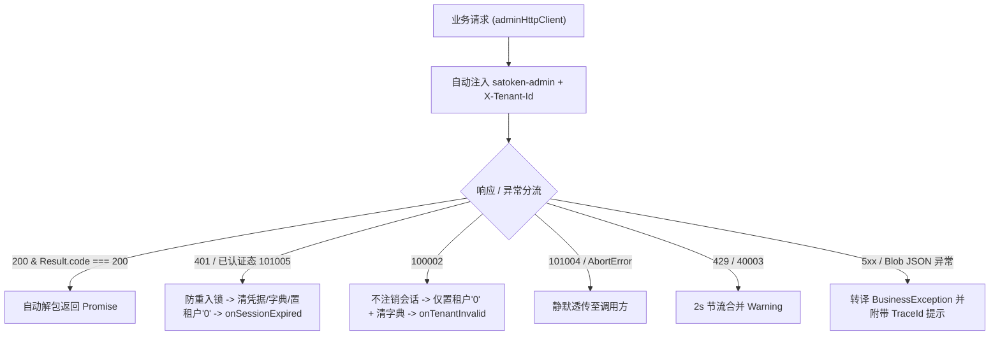

# ateng-solid-admin-web 管理后台前端工程

**ateng-solid-admin-web** 是 **ateng-solid** 全端开源上层框架的管理后台 Web 前端工程，基于 [`ateng-ui`](https://github.com/atengk/ateng-ui) 基础设施套件（`@atengk/core`、`@atengk/vue`、`@atengk/element-plus`）与 **TailwindCSS v4（禁用 Preflight）+ `Precision Slate & Cobalt` 自有令牌**混合样式架构构建。

> 当前已落地 `Spec 1`（设计令牌与无 Preflight 样式底座、HTTP 三单例与全局异常分流、双轨字典与图标工具、静态枚举/字典只读契约及 Vitest 离线隔离基线）；登录视图、动态路由、Pinia Store 与系统管理业务页面将于后续 `Spec 2 ~ Spec 4` 逐步交付。

---

## 0. 已落地前端基线全景速查矩阵 (`Spec 1`)

| 能力域          | 文件 / 导出成员                                                                | 关键机制 / 契约路径                                                                                                                 | 核心职责与边界守卫                                                                                                               | 锚定验证测试 (`*.spec.ts`)                               |
| :-------------- | :----------------------------------------------------------------------------- | :---------------------------------------------------------------------------------------------------------------------------------- | :------------------------------------------------------------------------------------------------------------------------------- | :------------------------------------------------------- |
| 首屏防闪烁      | [`index.html`](./index.html)                                                   | `localStorage.getItem('solid-theme-mode')`                                                                                          | `<head>` 同步脚本预补 `html.dark`（匹配 `'dark'` 或 `'auto'` + 系统偏好）                                                        | `vite build` / 人工验证                                  |
| 自有视觉令牌    | [`src/styles/tokens.css`](./src/styles/tokens.css)                             | `--solid-*`、`--el-color-primary*`、`--at-shadow-focus-ring`                                                                        | 全局唯一 Hex 真源，静态定义 Light (`#1D4ED8`) / Dark (`#3B82F6`) 双态                                                            | `vite build`                                             |
| 混合样式入口    | [`src/styles/main.css`](./src/styles/main.css)                                 | `@theme`、`@custom-variant dark`、`.tabular-nums`                                                                                   | 严格 6 段导入序，彻底剥离 `theme-pro.css` 且禁 `preflight.css`                                                                   | [`tests/smoke.spec.ts`](./tests/smoke.spec.ts)           |
| HTTP 与会话单例 | [`src/utils/http.ts`](./src/utils/http.ts)                                     | `adminAuthManager`、`adminTenantManager`、`adminHttpClient`、`registerHttpErrorHandlers`                                            | 注入 `satoken-admin` / `X-Tenant-Id`；防重入 `401`、条件 `101005`、回退 `100002`、透传 `101004`、`429/40003` 节流、Blob 双态转译 | [`tests/utils/http.spec.ts`](./tests/utils/http.spec.ts) |
| 双轨字典引擎    | [`src/utils/dict.ts`](./src/utils/dict.ts)                                     | `setupDictManager`、`normalizeTagType`                                                                                              | `/[A-Z]/` 路由静态枚举、`snake_case` 路由动态字典，滤除 `'default'`                                                              | [`tests/utils/dict.spec.ts`](./tests/utils/dict.spec.ts) |
| 图标解析工具    | [`src/utils/icon.ts`](./src/utils/icon.ts)                                     | `resolveMenuIcon`、`TAB_MENU_ICONS`                                                                                                 | `Map` 安全解析 `@element-plus/icons-vue`（阻断原型链查找）与线性页签菜单图标                                                     | [`tests/utils/icon.spec.ts`](./tests/utils/icon.spec.ts) |
| 通用类型契约    | [`src/api/types.ts`](./src/api/types.ts)                                       | `CommonStatus`、`GenderValue`、`MenuType`、`YesNoValue`、`VisibleStatus`、`TagType`、`` `OptionItem<T>` ``、`` `SelectOption<T>` `` | 跨模块基础强类型原语（零 `any`、雪花 ID 一律 `string`）                                                                          | `vue-tsc --noEmit`                                       |
| 静态枚举 API    | [`src/api/system/enum.ts`](./src/api/system/enum.ts)                           | `getAllEnums`、`getEnumByName`、`getEnumsBatch`                                                                                     | 对接 `GET /admin/system/enums*` 与 `POST /admin/system/enums/batch`                                                              | [`tests/utils/dict.spec.ts`](./tests/utils/dict.spec.ts) |
| 动态字典 API    | [`src/api/system/dict.ts`](./src/api/system/dict.ts)                           | `DictDataVO`、`getDictDataByType`                                                                                                   | 对接 `GET /admin/system/dict/data/type/{dictType}`                                                                               | [`tests/utils/dict.spec.ts`](./tests/utils/dict.spec.ts) |
| 应用启动入口    | [`src/main.ts`](./src/main.ts)                                                 | `initTheme` + `setupDictManager` + `createAtengVue`                                                                                 | 严格按序装配中文语言包与三单例，收敛 `superAdminRoles: ['super_admin']`                                                          | `vue-tsc` / `vite build`                                 |
| 测试隔离基线    | [`tests/setup.ts`](./tests/setup.ts)、[`vitest.config.ts`](./vitest.config.ts) | `setupFiles: ['tests/setup.ts']`                                                                                                    | 每个用例前后强制清空 Storage、`DictManager`、认证/租户状态与 Mock                                                                | 全量 `vitest run`                                        |

---

## 1. 工程定位、技术栈与质量门禁

- **技术基线**：Node.js `22+` / pnpm `11+` / Vue `3.5+` / Vite `6+` / TypeScript Strict / Vue Router / Pinia / Element Plus / TailwindCSS v4（无 Preflight）。
- **本地联调说明**：通过被 `.gitignore` 忽略的 `.env.local` 覆盖代理目标与开关（模板见 [`.env.example`](./.env.example)）；当前联调期本地保留 `.yalc/@atengk/element-plus`，正式提交 `package.json` 前须还原为已发布的 npm 正式版。

```bash
# 安装依赖与启动开发
pnpm install
pnpm dev

# 提交前四合一验证门禁
pnpm typecheck && pnpm lint && pnpm test && pnpm build
```

---

## 2. 核心链路与双轨分流架构



---

## 3. 核心基线能力详解

### 3.1 `Precision Slate & Cobalt` 令牌与无 Preflight 样式（`tokens.css` / `main.css`）

1. **配置基线（`src/styles/main.css` 6 段导入序 + `initTheme`）**：
   - 彻底移除 `@atengk/element-plus/theme-pro.css`，按序导入 `element-plus/dist/index.css` ➔ `element-plus/theme-chalk/dark/css-vars.css` ➔ `@atengk/element-plus/style.css` ➔ `./tokens.css` ➔ `tailwindcss/theme.css` ➔ `tailwindcss/utilities.css`。
2. **启动装配（提取自 [`src/main.ts`](./src/main.ts)）**：

```ts
initTheme({
  storageKey: 'solid-theme-mode',
  defaultMode: 'light',
  listenSystemPreference: true,
});
```

3. **边界防御**：`initTheme` 严禁传入 `themeColor`，避免内联样式覆盖 Light (`#1D4ED8`) / Dark (`#3B82F6`) 双主色切换；除 `tokens.css` 外全站样式与组件禁止硬编码十六进制颜色。

### 3.2 三单例 HTTP 客户端与全局错误分流（`src/utils/http.ts`）

1. **配置项（`.env.example`）**：

```ini
VITE_API_BASE_URL=
VITE_PROXY_TARGET=http://127.0.0.1:8080
```

2. **上层解耦回调注册（提取自 [`src/utils/http.ts`](./src/utils/http.ts)）**：

```ts
registerHttpErrorHandlers({
  onSessionExpired: async (_reason, _message) => {
    // 清理 Pinia 认证/动态路由状态并跳转 /login
  },
  onTenantInvalid: async _message => {
    // 刷新 /admin/auth/info 与 /admin/auth/routes 并回退 /dashboard
  },
});
```

3. **边界防御**：
   - `adminTenantManager` 本地为空时自动初始化写入 `'0'`；
   - `101005` 严格区分是否已认证请求（未认证态如登录表单提交直接透传业务异常，已认证态执行全端会话清理）；
   - `Blob` 下载遇 HTTP `4xx/5xx` 返回 JSON 错误体时，经 `checkBlobForJsonError` 二次兜底转译为强类型 `BusinessException`。

### 3.3 正交双轨 `DictManager` 与图标解析（`src/utils/dict.ts`、`src/utils/icon.ts`）

1. **装配调用（提取自 `src/main.ts` 与 `src/utils/icon.ts`）**：

```ts
setupDictManager();
const icon = resolveMenuIcon('UserFilled');
```

2. **真实请求协议**：
   - 静态枚举（`/[A-Z]/`，如 `dataScopeType`）：单查 `GET /admin/system/enums/{name}`，批查合并发送 `POST /admin/system/enums/batch`（请求体直传字符串数组 `string[]`）；
   - 动态字典（纯小写 `snake_case`，如 `sys_user_gender`）：走 `GET /admin/system/dict/data/type/{dictType}`；
   - `normalizeTagType` 统一过滤 `'default'`、空白与非法值返回 `undefined`，避免 Tag 渲染报错；
   - `resolveMenuIcon` 支持 PascalCase、kebab-case 与 `el-icon-*` 前缀，基于 `Map` 查找绝不命中 `toString`/`constructor` 等原型链键。

---

## 4. 规范与架构文档导航

- 独立开发行为准则：[`AGENTS.md`](./AGENTS.md)
- 跨端通信契约（同步副本）：[`docs/agents/contracts.md`](./docs/agents/contracts.md)
- 底层缺口即停工与联调 SOP（同步副本）：[`docs/agents/foundation-first-gate.md`](./docs/agents/foundation-first-gate.md)
- 编码、架构拆解与注释规范（同步副本）：[`docs/agents/coding-standards.md`](./docs/agents/coding-standards.md)
- 文档 1:1 保真规范（同步副本）：[`docs/agents/documentation-specification.md`](./docs/agents/documentation-specification.md)
- 混合样式与 `ateng-ui` 接入守则：[`docs/agents/styling-and-ateng-ui.md`](./docs/agents/styling-and-ateng-ui.md)
- 前端 AI 全景索引：[`llms.txt`](./llms.txt)
- 前端领域词汇表：[`CONTEXT.md`](./CONTEXT.md)
- 前端架构决策记录：[`docs/adr/README.md`](./docs/adr/README.md)
- 工程结构与路由权限规范：[`docs/specs/frontend-architecture-and-conventions.md`](./docs/specs/frontend-architecture-and-conventions.md)
- 页面视图、动态路由与 Store 规格：[`docs/specs/views-and-routes-spec.md`](./docs/specs/views-and-routes-spec.md)

---

## 5. 环境变量字典与开源协议

| 环境变量            | `.env.example` 默认值   | 用途                                      |
| :------------------ | :---------------------- | :---------------------------------------- |
| `VITE_APP_TITLE`    | `ateng-solid 管理后台`  | 页面标题与根骨架标题                      |
| `VITE_PORT`         | `5173`                  | 本地 Vite 开发服务端口                    |
| `VITE_API_BASE_URL` | `""`（留空）            | 接口请求基地址（默认走 `/admin/**` 代理） |
| `VITE_PROXY_TARGET` | `http://127.0.0.1:8080` | Vite 本地开发环境后端代理目标             |

- 仓库采用 `main`（稳定只读）+ `dev`（活跃开发）双分支，提交流程详见 [贡献指南 (`CONTRIBUTING.md`)](./CONTRIBUTING.md)，安全漏洞披露详见 [安全策略 (`SECURITY.md`)](./SECURITY.md)。
- 基于 [Apache License 2.0](./LICENSE) 协议开源。
