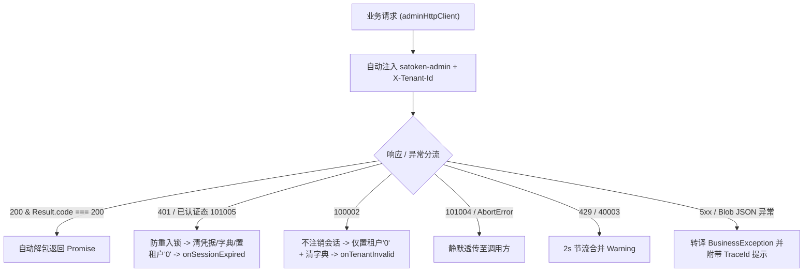

# ateng-solid-admin-web 管理后台前端工程

**ateng-solid-admin-web** 是 **ateng-solid** 全端开源上层框架的管理后台 Web 前端工程，基于 [`ateng-ui`](https://github.com/atengk/ateng-ui) 基础设施套件（`@atengk/core`、`@atengk/vue`、`@atengk/element-plus`）与 **TailwindCSS v4（禁用 Preflight）+ `Precision Slate & Cobalt` 自有令牌**混合样式架构构建。

> 当前已落地 `Spec 1`（设计令牌、HTTP 三单例与全局异常分流、双轨字典与图标工具、Vitest 隔离基线）与 `Spec 2` 状态/路由/布局基础（`/admin/auth/**` 11 端点、4 个 Pinia Setup Store、动态路由守卫、方案 A 轻量 `AdminLayout` 布局壳、全局组件与 `403`/`404` 异常页）；各业务域管理视图页面将在后续工单逐步充实。

---

## 0. 已落地前端基线全景速查矩阵 (`Spec 1` + `Spec 2` 基线)

| 能力域          | 文件 / 导出成员                                                                                                                                                                                                                                                                      | 关键机制 / 契约路径                                                                                                                                                                                     | 核心职责与边界守卫                                                                                                                | 锚定验证测试 (`*.spec.ts`)                                                           |
| :-------------- | :----------------------------------------------------------------------------------------------------------------------------------------------------------------------------------------------------------------------------------------------------------------------------------- | :------------------------------------------------------------------------------------------------------------------------------------------------------------------------------------------------------ | :-------------------------------------------------------------------------------------------------------------------------------- | :----------------------------------------------------------------------------------- |
| 首屏防闪烁      | [`index.html`](./index.html)                                                                                                                                                                                                                                                         | `localStorage.getItem('solid-theme-mode')`                                                                                                                                                              | `<head>` 同步脚本预补 `html.dark`（匹配 `'dark'` 或 `'auto'` + 系统偏好）                                                         | `vite build` / 人工验证                                                              |
| 自有视觉令牌    | [`src/styles/tokens.css`](./src/styles/tokens.css)                                                                                                                                                                                                                                   | `--solid-*`、`--el-color-primary*`、`--at-shadow-focus-ring`                                                                                                                                            | 全局唯一 Hex 真源，静态定义 Light (`#1D4ED8`) / Dark (`#3B82F6`) 双态                                                             | `vite build`                                                                         |
| 混合样式入口    | [`src/styles/main.css`](./src/styles/main.css)                                                                                                                                                                                                                                       | `@theme`、`@custom-variant dark`、`.tabular-nums`                                                                                                                                                       | 严格 6 段导入序，彻底剥离 `theme-pro.css` 且禁 `preflight.css`                                                                    | [`tests/smoke.spec.ts`](./tests/smoke.spec.ts)                                       |
| HTTP 与会话单例 | [`src/utils/http.ts`](./src/utils/http.ts)                                                                                                                                                                                                                                           | `adminAuthManager`、`adminTenantManager`、`adminHttpClient`、`registerHttpErrorHandlers`                                                                                                                | 注入 `satoken-admin` / `X-Tenant-Id`；防重入 `401`、条件 `101005`、回退 `100002`、透传 `101004`、`429/40003` 节流、Blob 双态转译  | [`tests/utils/http.spec.ts`](./tests/utils/http.spec.ts)                             |
| 双轨字典引擎    | [`src/utils/dict.ts`](./src/utils/dict.ts)                                                                                                                                                                                                                                           | `setupDictManager`、`normalizeTagType`                                                                                                                                                                  | `/[A-Z]/` 路由静态枚举、`snake_case` 路由动态字典，滤除 `'default'`                                                               | [`tests/utils/dict.spec.ts`](./tests/utils/dict.spec.ts)                             |
| 图标解析工具    | [`src/utils/icon.ts`](./src/utils/icon.ts)                                                                                                                                                                                                                                           | `resolveMenuIcon`、`TAB_MENU_ICONS`                                                                                                                                                                     | `Map` 安全解析 `@element-plus/icons-vue`（阻断原型链查找）与线性页签菜单图标                                                      | [`tests/utils/icon.spec.ts`](./tests/utils/icon.spec.ts)                             |
| 通用与路由类型  | [`src/api/types.ts`](./src/api/types.ts)、[`src/types/router.ts`](./src/types/router.ts)                                                                                                                                                                                             | `CommonStatus`、`GenderValue`、`MenuType`、`SidebarMenuGroup`、`` `OptionItem<T>` ``、`RouteMeta` 扩展                                                                                                  | 跨模块基础强类型原语与路由元数据扩展（零 `any`、雪花 ID 一律 `string`）                                                           | `vue-tsc --noEmit`                                                                   |
| 认证中心 API    | [`src/api/auth/index.ts`](./src/api/auth/index.ts)、[`src/api/auth/types.ts`](./src/api/auth/types.ts)                                                                                                                                                                               | `getCaptcha`、`login`、`logout`、`getAuthInfo`、`getAuthRoutes`、`getPersonalProfile`、`updatePersonalProfile`、`uploadProfileAvatar`、`updatePassword`、`getOnlineSessionPage`、`kickoutOnlineSession` | 1:1 强类型覆盖 `/admin/auth/**` 全量 11 个端点；数组与 `` `PageResult<OnlineSessionVO>` `` 均空安全兜底 `[]`                      | [`tests/api/auth.spec.ts`](./tests/api/auth.spec.ts)                                 |
| 租户选项 API    | [`src/api/system/tenant.ts`](./src/api/system/tenant.ts)                                                                                                                                                                                                                             | `TenantOptionVO`、`getTenantOptions`                                                                                                                                                                    | 对接 `GET /admin/system/tenant/options`，供平台超管切租户下拉消费                                                                 | [`tests/api/auth.spec.ts`](./tests/api/auth.spec.ts)                                 |
| 静态枚举 API    | [`src/api/system/enum.ts`](./src/api/system/enum.ts)                                                                                                                                                                                                                                 | `getAllEnums`、`getEnumByName`、`getEnumsBatch`                                                                                                                                                         | 对接 `GET /admin/system/enums*` 与 `POST /admin/system/enums/batch`                                                               | [`tests/utils/dict.spec.ts`](./tests/utils/dict.spec.ts)                             |
| 动态字典 API    | [`src/api/system/dict.ts`](./src/api/system/dict.ts)                                                                                                                                                                                                                                 | `DictDataVO`、`getDictDataByType`                                                                                                                                                                       | 对接 `GET /admin/system/dict/data/type/{dictType}`                                                                                | [`tests/utils/dict.spec.ts`](./tests/utils/dict.spec.ts)                             |
| 认证权限 Store  | [`src/stores/auth.ts`](./src/stores/auth.ts)                                                                                                                                                                                                                                         | `useAuthStore`（`token`、`user`、`roles`、`permissions`、`isInitialized`、`tenantEnabled`、`login`、`fetchUserInfo`、`logout`、`clearLocalSession`、`hasPermission`、`hasRole`）                        | 代理 `useAuth({ authManager: adminAuthManager, superAdminRoles: ['super_admin'] })` 共享 `WeakMap`，杜绝 `admin` 免检与状态漂移   | [`tests/stores/auth.spec.ts`](./tests/stores/auth.spec.ts)                           |
| 多租户 Store    | [`src/stores/tenant.ts`](./src/stores/tenant.ts)                                                                                                                                                                                                                                     | `useTenantStore`（`activeTenantId`、`isSuperAdminTenantSwitchAllowed`、`isObservingTenant`、`switchTenant`、`resetToPlatform`、`recoverFromInvalidTenant`）                                             | 桥接 `adminTenantManager`；锁定普通用户归属租户；7 步强时序切租户；`100002` 回退 `'0'` 不断会话                                   | [`tests/stores/tenant.spec.ts`](./tests/stores/tenant.spec.ts)                       |
| 动态菜单 Store  | [`src/stores/permission.ts`](./src/stores/permission.ts)                                                                                                                                                                                                                             | `usePermissionStore`（`rawMenus`、`sidebarGroups`、`routesLoaded`、`registeredRouteNames`、`buildRoutes`、`resetRoutes`）                                                                               | 纯内存维护；`import.meta.glob('../views/**/*.vue')` 动态映射与 404 安全降级；精确 `removeRoute`                                   | [`tests/stores/permission.spec.ts`](./tests/stores/permission.spec.ts)               |
| UI 偏好 Store   | [`src/stores/app.ts`](./src/stores/app.ts)                                                                                                                                                                                                                                           | `useAppStore`、`initAppTheme`、`cleanupAppTheme`                                                                                                                                                        | 仅存 `solid-theme-mode`/`solid-sidebar-collapsed`/`solid-show-tabs`；提供 `registerTabsResetHandler` 与 `dispose` 资源清理        | [`tests/stores/auth.spec.ts`](./tests/stores/auth.spec.ts)                           |
| 静态路由与守卫  | [`src/router/routes.ts`](./src/router/routes.ts)、[`src/router/guards.ts`](./src/router/guards.ts)、[`src/router/index.ts`](./src/router/index.ts)                                                                                                                                   | `staticRoutes`、`setupRouterGuards`、`sanitizeRedirectTarget`、`createAppRouter`                                                                                                                        | 匿名白名单、同源单斜杠 `redirect` 防开放重定向、首次并行拉取 `info`+`routes`、零菜单 `/403` 保护及 `AtengLoadingBar` 联动         | [`tests/router/guards.spec.ts`](./tests/router/guards.spec.ts)                       |
| 应用启动入口    | [`src/main.ts`](./src/main.ts)                                                                                                                                                                                                                                                       | 8 步确定性装配时序                                                                                                                                                                                      | `initAppTheme` ➔ `setupDictManager` ➔ `pinia` ➔ `ElementPlus` ➔ `createAtengVue` ➔ `AtengElementPlus` ➔ `guards+router` ➔ `mount` | `vue-tsc` / `vite build`                                                             |
| 根组件容器      | [`src/App.vue`](./src/App.vue)                                                                                                                                                                                                                                                       | `<el-config-provider :locale="zhCn">` + `<router-view />`                                                                                                                                               | 全站注入 Element Plus 中文语言包并承载路由出口                                                                                    | [`tests/smoke.spec.ts`](./tests/smoke.spec.ts)                                       |
| 方案 A 布局壳   | [`AdminLayout.vue`](./src/layouts/AdminLayout.vue)、[`AdminSidebar.vue`](./src/layouts/AdminSidebar.vue)、[`AdminHeader.vue`](./src/layouts/AdminHeader.vue)、[`TenantObserveBanner.vue`](./src/layouts/TenantObserveBanner.vue)、[`layoutHelper.ts`](./src/layouts/layoutHelper.ts) | `useTabsNav`、`AtengTabsNav`、`ATENG_PRO_LAYOUT_KEY`、`SOLID_LAYOUT_TABS_KEY`                                                                                                                           | `228px`/`60px` 平铺分组侧栏、`48px` 顶栏、`36px` 线型页签（单源批关闭）与观察态琥珀金通栏；含 `Esc` 退出最大化与 `<768px` 抽屉    | [`tests/components/AdminLayout.spec.ts`](./tests/components/AdminLayout.spec.ts)     |
| 全局布局组件    | [`TenantSwitcher.vue`](./src/components/TenantSwitcher.vue)、[`ThemeToggle.vue`](./src/components/ThemeToggle.vue)、[`CommandPalette.vue`](./src/components/CommandPalette.vue)                                                                                                      | `tenantEnabled`、`setThemeMode`、`Ctrl+K` / `Cmd+K`                                                                                                                                                     | 超管可搜切租户 / 普通租户只读胶囊 / 单租户隐身；明暗主题切换；可见菜单快捷键搜索跳转（卸载清理监听）                              | [`tests/components/ShellControls.spec.ts`](./tests/components/ShellControls.spec.ts) |
| 异常兜底页      | [`403.vue`](./src/views/error/403.vue)、[`404.vue`](./src/views/error/404.vue)、[`ErrorResultShell.vue`](./src/views/error/ErrorResultShell.vue)                                                                                                                                     | `/403`、`/:pathMatch(.*)*`                                                                                                                                                                              | `403` 对持菜单登录态嵌入壳内，对零菜单登录态提供 `[退出登录]` 防死锁出口；`404` 提供回工作台、返回上一页与关闭当前页签            | [`tests/components/ShellControls.spec.ts`](./tests/components/ShellControls.spec.ts) |
| 测试隔离基线    | [`tests/setup.ts`](./tests/setup.ts)、[`vitest.config.ts`](./vitest.config.ts)                                                                                                                                                                                                       | `setupFiles: ['tests/setup.ts']`                                                                                                                                                                        | 每个用例前后清空 Storage、`DictManager`、`useAuth` `WeakMap`、租户状态与 Mock                                                     | 全量 `vitest run`                                                                    |

---

## 1. 工程定位、技术栈与质量门禁

- **技术基线**：Node.js `22+` / pnpm `11+` / Vue `3.5+` / Vite `6+` / TypeScript Strict / Vue Router / Pinia / Element Plus / TailwindCSS v4（无 Preflight）。
- **本地联调说明**：通过被 `.gitignore` 忽略的 `.env.local` 覆盖代理目标与开关（模板见 [`.env.example`](./.env.example)）；当前联调期本地保留 `.yalc/@atengk/element-plus`，正式提交 `package.json` 前须还原为已发布的 npm 正式版。

```bash
# 安装依赖与启动开发
pnpm install
pnpm dev

# 提交前四合一验证门禁
pnpm typecheck && pnpm lint && pnpm test && pnpm build
```

---

## 2. 核心链路与双轨分流架构



---

## 3. 核心基线能力详解

### 3.1 `Precision Slate & Cobalt` 令牌与无 Preflight 样式（`tokens.css` / `main.css`）

1. **配置基线（`src/styles/main.css` 6 段导入序 + `initTheme`）**：
   - 彻底移除 `@atengk/element-plus/theme-pro.css`，按序导入 `element-plus/dist/index.css` ➔ `element-plus/theme-chalk/dark/css-vars.css` ➔ `@atengk/element-plus/style.css` ➔ `./tokens.css` ➔ `tailwindcss/theme.css` ➔ `tailwindcss/utilities.css`。
2. **启动装配（提取自 [`src/stores/app.ts`](./src/stores/app.ts) 与 [`src/main.ts`](./src/main.ts)）**：

```ts
// src/stores/app.ts
sharedThemeManager = initTheme({
  storageKey: THEME_MODE_STORAGE_KEY,
  defaultMode: 'light',
  listenSystemPreference: true,
});

// src/main.ts
initAppTheme();
```

3. **边界防御**：`initTheme` 严禁传入 `themeColor`，避免内联样式覆盖 Light (`#1D4ED8`) / Dark (`#3B82F6`) 双主色切换；除 `tokens.css` 外全站样式与组件禁止硬编码十六进制颜色。

### 3.2 三单例 HTTP 客户端与全局错误分流（`src/utils/http.ts`）

1. **配置项（`.env.example`）**：

```ini
VITE_API_BASE_URL=
VITE_PROXY_TARGET=http://127.0.0.1:8080
```

2. **上层解耦回调注册（提取自 [`src/utils/http.ts`](./src/utils/http.ts)）**：

```ts
registerHttpErrorHandlers({
  onSessionExpired: async (_reason, _message) => {
    // 清理 Pinia 认证/动态路由状态并跳转 /login
  },
  onTenantInvalid: async _message => {
    // 刷新 /admin/auth/info 与 /admin/auth/routes 并回退 /dashboard
  },
});
```

3. **边界防御**：
   - `adminTenantManager` 本地为空时自动初始化写入 `'0'`；
   - `101005` 严格区分是否已认证请求（未认证态如登录表单提交直接透传业务异常，已认证态执行全端会话清理）；
   - `Blob` 下载遇 HTTP `4xx/5xx` 返回 JSON 错误体时，经 `checkBlobForJsonError` 二次兜底转译为强类型 `BusinessException`。

### 3.3 正交双轨 `DictManager` 与图标解析（`src/utils/dict.ts`、`src/utils/icon.ts`）

1. **装配调用（提取自 `src/main.ts` 与 `src/utils/icon.ts`）**：

```ts
setupDictManager();
const icon = resolveMenuIcon('UserFilled');
```

2. **真实请求协议**：
   - 静态枚举（`/[A-Z]/`，如 `dataScopeType`）：单查 `GET /admin/system/enums/{name}`，批查合并发送 `POST /admin/system/enums/batch`（请求体直传字符串数组 `string[]`）；
   - 动态字典（纯小写 `snake_case`，如 `sys_user_gender`）：走 `GET /admin/system/dict/data/type/{dictType}`；
   - `normalizeTagType` 统一过滤 `'default'`、空白与非法值返回 `undefined`，避免 Tag 渲染报错；
   - `resolveMenuIcon` 支持 PascalCase、kebab-case 与 `el-icon-*` 前缀，基于 `Map` 查找绝不命中 `toString`/`constructor` 等原型链键。

### 3.4 认证、多租户状态与动态路由守卫（`src/stores/`、`src/router/`、`src/main.ts`）

1. **配置与启动装配（提取自 [`src/main.ts`](./src/main.ts)）**：
   - 严格遵循 8 步启动顺序：`initAppTheme()` ➔ `setupDictManager()` ➔ `app.use(pinia)` ➔ `app.use(ElementPlus, { locale: zhCn })` ➔ `app.use(createAtengVue({ httpClient: adminHttpClient, authManager: adminAuthManager, tenantManager: adminTenantManager, superAdminRoles: ['super_admin'], defaultSize: 10 }))` ➔ `app.use(AtengElementPlus)` ➔ 接线 `registerHttpErrorHandlers` + `setupRouterGuards(router, pinia)` + `app.use(router)` ➔ `app.mount('#app')`。
2. **核心调用示例（提取自 [`src/stores/auth.ts`](./src/stores/auth.ts) 与 [`src/stores/tenant.ts`](./src/stores/tenant.ts)）**：

```ts
const authStore = useAuthStore(pinia);
const tenantStore = useTenantStore(pinia);

await authStore.login(loginForm);
await Promise.all([authStore.fetchUserInfo(), permissionStore.buildRoutes(router)]);
await tenantStore.switchTenant('10002', router);
```

3. **边界防御**：
   - **单源权限零漂移**：`useAuthStore` 代理 `useAuth({ authManager: adminAuthManager, superAdminRoles: ['super_admin'] })` 底层 `WeakMap`，彻底隔离并禁用 `'admin'` 默认超管免检；
   - **超管 7 步切租户与 `100002` 回退**：普通租户用户在 `initForUser` 强制矫正回真实归属 `tenantId` 并阻断越权切换；超管切换按“写租户头 ➔ 清字典 ➔ 关非固定页签 ➔ 卸旧路由 ➔ 并行重拉 `info`+`routes` ➔ 不可见页面回退 `/dashboard` ➔ 更新名称”严格串行执行，遇 `100002` 回退 `'0'` 且不注销平台超管会话；
   - **安全守卫与 404 降级**：未登录仅放行 `/login` 与 `/403`（未知路径跳 `/login?redirect=...`）；`sanitizeRedirectTarget` 递归解码拦截协议外链（`https://`、`//`、`/\`）与 `/login`/`/403`/`/404`；动态 `component` 在 `import.meta.glob('../views/**/*.vue')` 未命中时自动降级 404，零菜单账户访问未授权动态路径重定向至 `/403`。

### 3.5 方案 A 轻量布局壳与全局协同组件（`src/layouts/`、`src/components/`、`src/views/error/`）

1. **核心配置与布局骨架（[`AdminLayout.vue`](./src/layouts/AdminLayout.vue)）**：
   - 采用 TailwindCSS v4 Flex 构筑 `228px`/`60px` 侧栏（[`AdminSidebar.vue`](./src/layouts/AdminSidebar.vue)）、`48px` 单行顶栏（[`AdminHeader.vue`](./src/layouts/AdminHeader.vue)）、`36px` 线型多页签栏（`AtengTabsNav`）与 `36px` 跨租户观察态琥珀金通栏（[`TenantObserveBanner.vue`](./src/layouts/TenantObserveBanner.vue)），完全基于 `--solid-*` 语义令牌，零负 `margin` 与零全局 `!important`。
2. **真实调用绑定（提取自 [`AdminLayout.vue`](./src/layouts/AdminLayout.vue)）**：

```vue
<AtengTabsNav
  v-if="appStore.showTabsBar"
  :model-value="tabsNav.activeKey.value"
  :tabs="tabsNav.tabs.value"
  style-type="line"
  height="36px"
  :emit-close-on-batch="false"
  :is-maximized="tabsNav.isMaximized.value"
  :icon-resolver="resolveTabIcon"
  :menu-icons="TAB_MENU_ICONS"
  @tab-click="handleTabClick"
  @tab-close="handleTabClose"
  @batch-close="handleBatchClose"
  @tab-refresh="handleTabRefresh"
  @tab-order-change="handleTabOrderChange"
  @update:is-maximized="handleUpdateMaximized"
/>
```

- 主骨架同时调用 `provide(ATENG_PRO_LAYOUT_KEY, layoutContext)` 与 `provide(SOLID_LAYOUT_TABS_KEY, ...)`，向子孙页面透传折叠态、侧栏宽度、最大化状态与关闭当前页签能力。

3. **边界防御**：
   - **单源批关闭与局部刷新**：关闭 `emitCloseOnBatch` 后经 `@batch-close` 一次性调用 `useTabsNav` 的 `closeOthers`/`closeLeft`/`closeRight`/`closeAll`，消除多标签连续关闭跳变；结合 `KeepAlive :include="tabsNav.cachedViews.value"` 与 `refreshingKey` 实现页签级原地重挂载；最大化模式同步隐藏左侧栏、顶栏与 `TenantObserveBanner`；
   - **全局监听回收与按键隔离**：`AdminLayout` 的 `Esc`/`resize`/`matchMedia` 监听与 [`CommandPalette.vue`](./src/components/CommandPalette.vue) 的 `Ctrl+K` / `Cmd+K` 监听均在 `onBeforeUnmount` 精确卸载，`tabsResetHandler` 同步置空；`CommandPalette` 展开时独占 `Esc`（`stopImmediatePropagation`），避免误退出底层工作区最大化；
   - **零菜单防死锁与观察态显式退出**：[`403.vue`](./src/views/error/403.vue) 对已登录持菜单账户自动嵌入 `AdminLayout`，对已登录零菜单账户显式渲染 `[退出登录]` 按钮避免死锁；[`TenantSwitcher.vue`](./src/components/TenantSwitcher.vue) 与 `TenantObserveBanner` 严格受 `tenantEnabled` 及 `isObservingTenant` 门控。

---

## 4. 规范与架构文档导航

- 独立开发行为准则：[`AGENTS.md`](./AGENTS.md)
- 跨端通信契约（同步副本）：[`docs/agents/contracts.md`](./docs/agents/contracts.md)
- 底层缺口即停工与联调 SOP（同步副本）：[`docs/agents/foundation-first-gate.md`](./docs/agents/foundation-first-gate.md)
- 编码、架构拆解与注释规范（同步副本）：[`docs/agents/coding-standards.md`](./docs/agents/coding-standards.md)
- 文档 1:1 保真规范（同步副本）：[`docs/agents/documentation-specification.md`](./docs/agents/documentation-specification.md)
- 混合样式与 `ateng-ui` 接入守则：[`docs/agents/styling-and-ateng-ui.md`](./docs/agents/styling-and-ateng-ui.md)
- 前端 AI 全景索引：[`llms.txt`](./llms.txt)
- 前端领域词汇表：[`CONTEXT.md`](./CONTEXT.md)
- 前端架构决策记录：[`docs/adr/README.md`](./docs/adr/README.md)
- 工程结构与路由权限规范：[`docs/specs/frontend-architecture-and-conventions.md`](./docs/specs/frontend-architecture-and-conventions.md)
- 页面视图、动态路由与 Store 规格：[`docs/specs/views-and-routes-spec.md`](./docs/specs/views-and-routes-spec.md)

---

## 5. 环境变量字典与开源协议

| 环境变量            | `.env.example` 默认值   | 用途                                      |
| :------------------ | :---------------------- | :---------------------------------------- |
| `VITE_APP_TITLE`    | `ateng-solid 管理后台`  | 页面标题与根骨架标题                      |
| `VITE_PORT`         | `5173`                  | 本地 Vite 开发服务端口                    |
| `VITE_API_BASE_URL` | `""`（留空）            | 接口请求基地址（默认走 `/admin/**` 代理） |
| `VITE_PROXY_TARGET` | `http://127.0.0.1:8080` | Vite 本地开发环境后端代理目标             |

- 仓库采用 `main`（稳定只读）+ `dev`（活跃开发）双分支，提交流程详见 [贡献指南 (`CONTRIBUTING.md`)](./CONTRIBUTING.md)，安全漏洞披露详见 [安全策略 (`SECURITY.md`)](./SECURITY.md)。
- 基于 [Apache License 2.0](./LICENSE) 协议开源。
